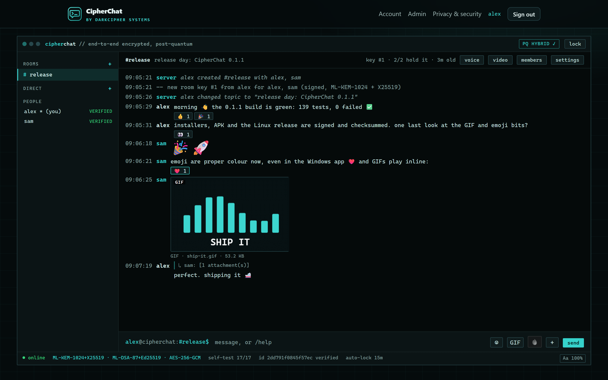
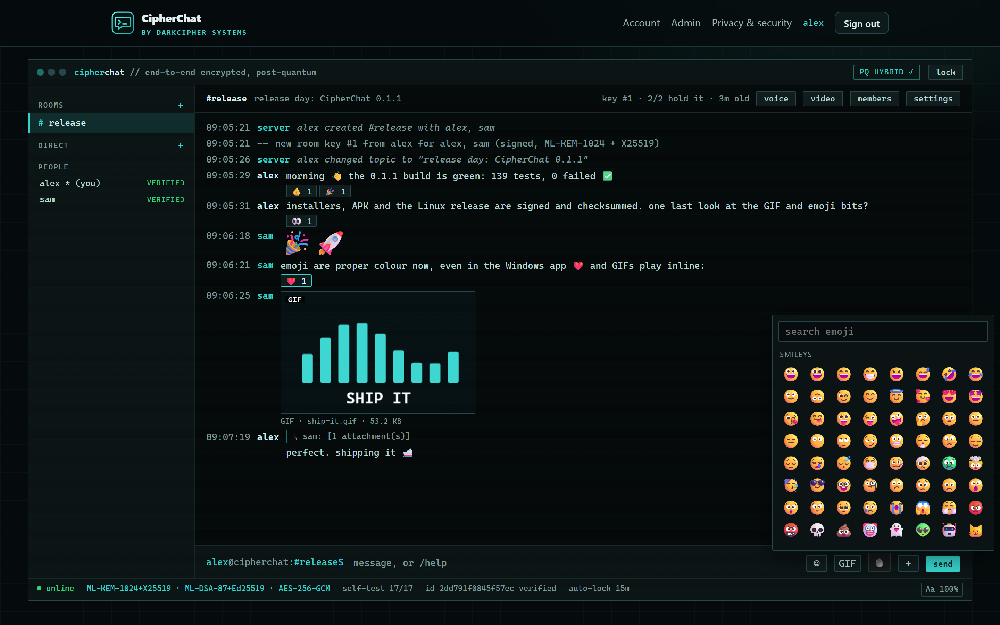
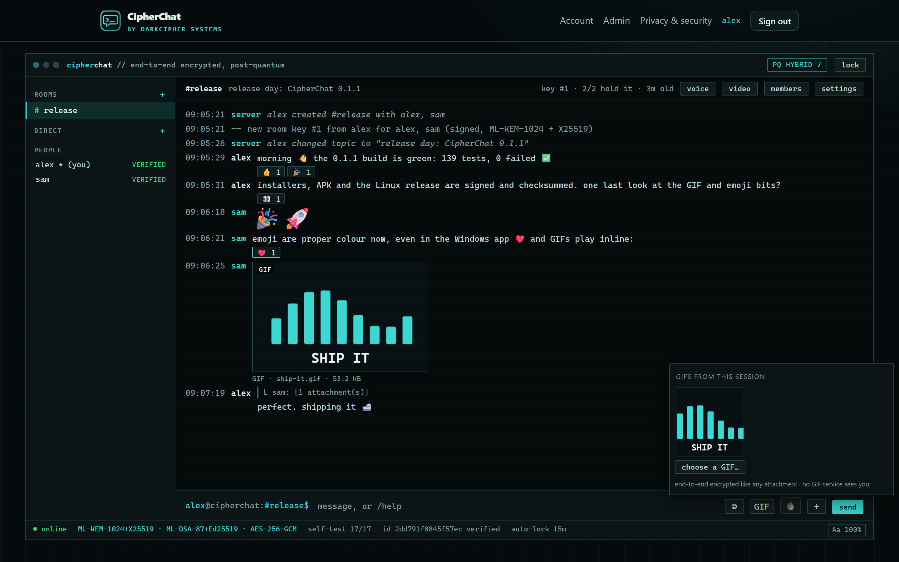
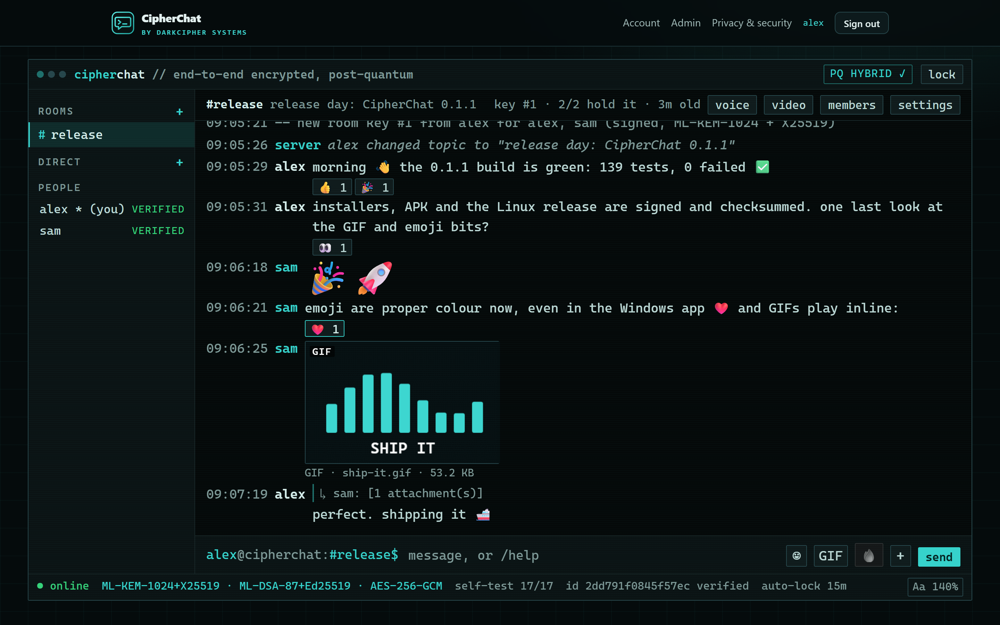
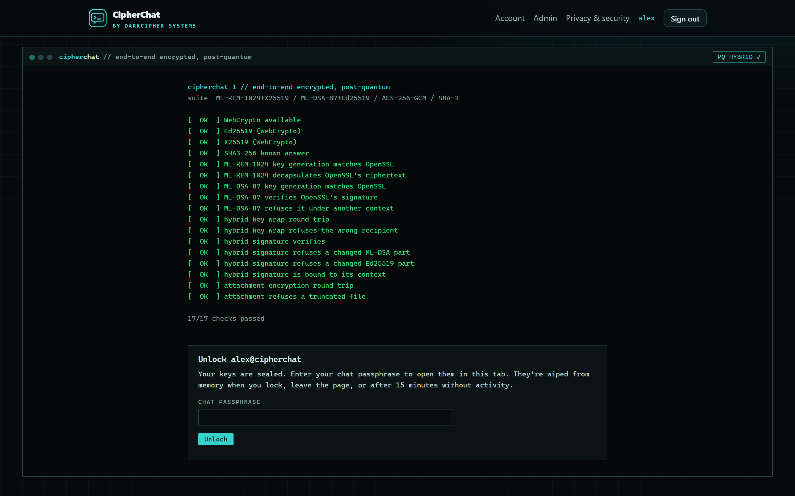
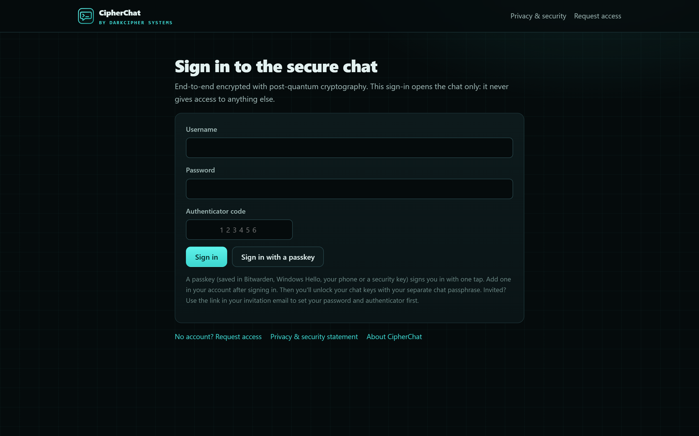
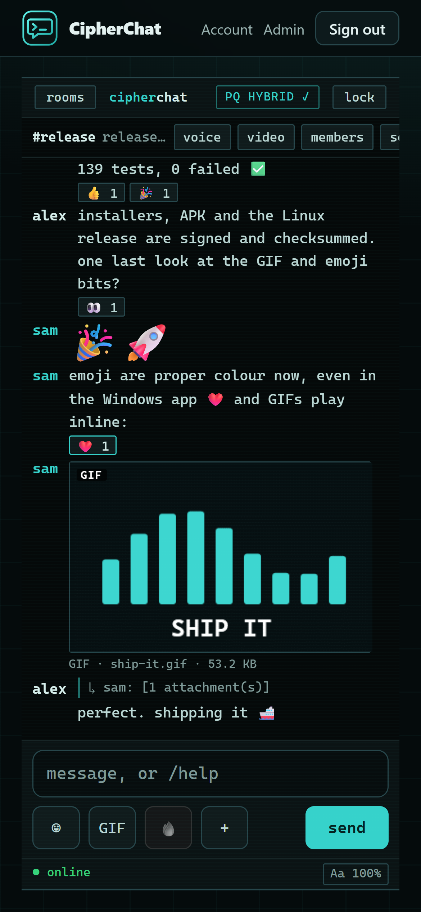

# CipherChat

**Post-quantum end-to-end encrypted chat, voice and video — on your own server.**
CipherChat by DarkCipher Systems, built by DarkCipher0x. MIT licence.

Rooms, direct messages, files and pictures, reactions, edits, burn-after-reading, and HD voice and video calls with up
to eight people, between the web, Windows and Android. Every message, file, key and call frame is protected with
hybrid post-quantum cryptography (ML-KEM-1024 + X25519, ML-DSA-87 + Ed25519, AES-256-GCM), and the apps reach the
server only over TLS 1.3 with X25519MLKEM768. The server stores ciphertext and can't read, forge or silently change
anything; trust rests on one owner whose key every member checks once with a 60-digit safety number.

## Why

Most chat apps keep your conversations on their servers, under their rules: they decide what is stored, who can read
it and who may use the service, and they can change that whenever they like. CipherChat exists to give that privacy
and freedom back to the people having the conversations. You run the server, the keys never leave your devices, the
server keeps no IP addresses and can't read anything it stores, there are no ads and no tracking, and the code is
open so anyone can check it does what it says.

## What's in the box

| Part | For | Where |
|---|---|---|
| **Server** (Python standard library) | Linux with nginx (own site, merged into a site you already run, or behind your proxy) + coturn for calls | `server/`, `deploy/` — guide: [docs/LINUX-SERVER.md](docs/LINUX-SERVER.md) |
| **Web chat** | any current browser, served by the server at `/chat/` | `web/` |
| **Windows app** | Windows 10 (2004+) / 11 | `windows/` — guide: [docs/WINDOWS.md](docs/WINDOWS.md) |
| **Android app** | Android 12+ | `android/` — guide: [docs/ANDROID.md](docs/ANDROID.md) |
| **Add-ons & connectors** | signed post-quantum add-on API, CommandCentre connector, .NET SDK | `windows/src/CipherChat.Addons`, `CipherChat.Connector` — guide: [docs/ADDONS.md](docs/ADDONS.md) |
| Mac / iOS | planned, same protocol | [docs/MAC-IOS-HANDOFF.md](docs/MAC-IOS-HANDOFF.md) |

## Downloads (release 0.1.1)

| File | What |
|---|---|
| `CipherChat-0.1.1-Setup.exe` | Windows app, themed installer (the MSI beside it is for administrators: `msiexec`, GPO, Intune) |
| `cipherchat-server-0.1.1-linux.tar.gz` | Linux server: `tar xzf …; sudo sh cipherchat-server-0.1.1/install.sh` |
| `CipherChat-0.1.1.apk` | Android app, signed (certificate SHA-256 in `android-signing-certificate.sha256`) |
| `CipherChat-Connector-0.1.1-win-x64.zip` | add-on connectors: CommandCentre (and any MCP system) in the chat — [docs/ADDONS.md](docs/ADDONS.md) |
| `SHA256SUMS` | checksums of everything |

## Screenshots

Demo people and messages only (the web chat; the Windows and Android apps show the same rooms).

| | |
|---|---|
|  |  |
| A room: colour emoji, reactions, big emoji-only messages and a GIF playing inline | The emoji picker, with search |
|  |  |
| GIFs of this session, to send again in a click (no GIF service involved) | Text size from 90% to 200% |
|  |  |
| Unlock: the browser checks its own post-quantum cryptography first | Sign in with password + authenticator, or a passkey |

## Using it

[docs/USER-GUIDE.md](docs/USER-GUIDE.md): setting up, verifying the owner, rooms, files, burn messages, calls and
call words, pairing more devices, passkeys (including Bitwarden).

## Security

* Running a server (settings, email, notifications, roles and permissions): [docs/ADMIN.md](docs/ADMIN.md)
* Design and guarantees: [SECURITY.md](SECURITY.md) and [docs/security/SECURITY-DESIGN.md](docs/security/SECURITY-DESIGN.md)
* Protocol specification: [docs/PROTOCOL.md](docs/PROTOCOL.md); calls: [docs/CALLS.md](docs/CALLS.md); cross-client
  interop: [docs/INTEROP.md](docs/INTEROP.md)
* Penetration test and debug sweep: [docs/security/PENTEST-2026-10.md](docs/security/PENTEST-2026-10.md)

## Building

| What | How |
|---|---|
| Server tests | `python3 -I server/tests/test_server.py` and `python3 -I server/tests/pentest_server.py` |
| Windows (tests, then installers) | `cd windows; dotnet test` · `powershell -File windows\tools\build-installers.ps1` |
| Android (tests, lint, signed APK) | `powershell -File android\tools\release.ps1` (key: `android\tools\new-release-key.ps1`, once ever) |
| Linux release | `sh tools/build-linux-release.sh 0.1.1` (on Linux or WSL) |
| Web call tests | serve `web/` on 127.0.0.1 and open `/tests/calltest.html` |

Requirements: .NET 8 SDK (Windows), JDK 21 + Android SDK 36 (`android/tools/env.ps1`), Python 3.10+ (server).
Dependencies are pinned (NuGet lock files; Gradle verification metadata with SHA-256 for BouncyCastle; vendored
JavaScript with integrity hashes in `web/app/vendor/VENDOR.json`).

Third-party software: [THIRD-PARTY-NOTICES.md](THIRD-PARTY-NOTICES.md).
